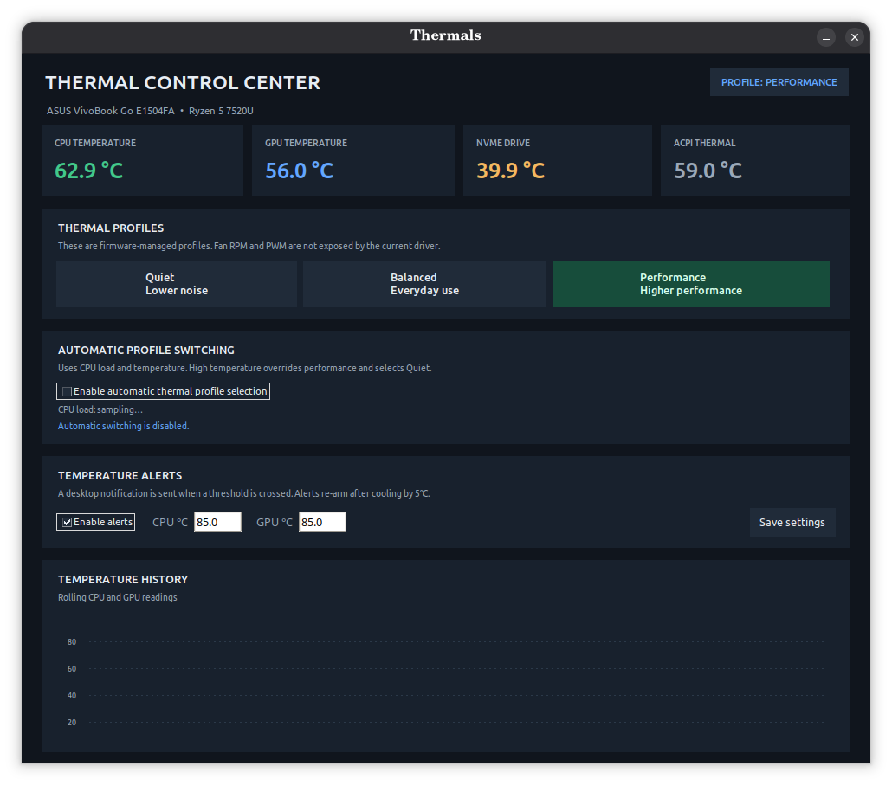
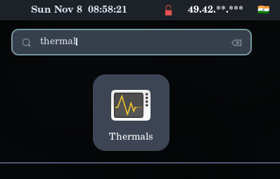
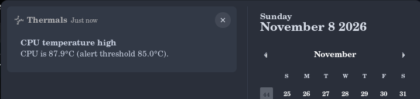

# Thermals

Thermals (Thermal Control Center) is a native Linux desktop application for monitoring hardware temperatures and managing ACPI thermal profiles. It provides an intuitive interface for real-time sensor telemetry, automated profile switching based on workload and temperature, and desktop alerts for thermal thresholds.

The application interacts strictly with Linux's standardized ACPI `platform_profile` subsystem. It avoids unsafe direct writes to Embedded Controller (EC) registers or raw PWM fan controls, relying entirely on vendor-approved firmware policies.



---

## Features

- **Multi-Sensor Telemetry Monitoring**
  - Real-time temperature monitoring for CPU, GPU, NVMe SSD, and ACPI thermal zones.
  - Primary metric extraction using `lm-sensors` with seamless fallback to kernel `sysfs` (`/sys/class/hwmon`).
  - Polling cycle of 2 seconds with background asynchronous execution to prevent UI freezing.

- **Firmware-Managed Thermal Profiles**
  - Supports standard ACPI platform profiles:
    - **Quiet**: Limits acoustic output and optimizes for low noise.
    - **Balanced**: Standard operational profile for general everyday usage.
    - **Performance**: Elevates power limits and fan curves for maximum throughput.
  - Active profile detection and dynamic UI button state synchronization.

- **Automated Workload & Temperature-Aware Profile Switching**
  - Heuristic profile selection driven by aggregate CPU utilization (`/proc/stat`) and temperature levels.
  - Thermal override logic: automatically reverts to conservative profiles under elevated thermal load to avoid throttling.
  - Anti-oscillation controls:
    - Multi-sample confirmation (requires 3 consecutive matching readings).
    - Minimum dwell timer (60 seconds) to prevent profile flapping during bursty workloads.

- **Desktop Temperature Alerts**
  - Configurable alert thresholds for CPU and GPU temperatures.
  - Native desktop notifications sent via `notify-send`.
  - Built-in 5°C reset hysteresis to prevent notification spam near threshold boundaries.

- **Rolling Temperature History**
  - 60-sample historical chart displaying CPU and GPU trends with smooth interpolation and dynamic grid scaling.

- **Secure Privilege Model**
  - The UI runs under an unprivileged user session.
  - Manual profile switching supports Polkit (`pkexec`) out of the box.
  - Automated switching can be authorized via a dedicated, narrowly-scoped helper script with strict `sudoers` allowlisting.

---

## Prerequisites

### Operating System and Kernel
- Linux distribution running kernel 5.8 or newer with ACPI platform profile support (`/sys/firmware/acpi/platform_profile`).
- Tested on ASUS laptops (e.g., ASUS VivoBook series) utilizing the `asus_wmi` / `asus_nb_wmi` kernel drivers, but compatible with any system exposing the ACPI platform profile interface (Lenovo, Dell, HP, ThinkPad).

### Required Dependencies
- Python 3.8 or later
- Python Tkinter interface (`python3-tk`)
- Hardware sensor utility: `lm-sensors` (recommended for optimal sensor parsing)
- Notification utility: `libnotify-bin` (for desktop threshold alerts)

On Debian and Ubuntu-based systems, install dependencies using:

```bash
sudo apt update
sudo apt install python3 python3-tk lm-sensors libnotify-bin
```

To configure sensor detection for your hardware, optionally run:

```bash
sudo sensors-detect --auto
```

---

## Installation

### Option A: Install via Debian Package (.deb)

Download the latest release package from the [GitHub Releases](https://github.com/Yash55-max/asus-thermals-control/releases) page:

```bash
sudo apt install ./asus-thermals-control_1.0.0_all.deb
```

### Option B: Install from Source

Clone or download this repository, navigate to the folder, and execute the installation script:

```bash
git clone https://github.com/Yash55-max/asus-thermals-control.git
cd asus-thermals-control
bash install-thermals.sh
```

This script performs the following actions:
- Copies application files to `~/.local/opt/thermals/`.
- Installs the desktop launcher to `~/.local/share/applications/thermals.desktop`.
- Updates the local desktop application database.

You can now search for **Thermals** in your desktop environment's application launcher.



### 2. Configure Unattended Profile Switching (Recommended)

Automatic profile switching runs continuously in the background while the application is open. To allow changing system thermal profiles without prompting for an authentication password every time a profile transition occurs, install the scoped privilege helper:

```bash
bash install-helper.sh
```

What this script configures:
1. Installs `/usr/local/sbin/asus-thermal-profile` owned by `root:root` with permissions `0755`.
2. Adds a sudoers configuration file at `/etc/sudoers.d/asus-thermal-control` restricted specifically to your username.
3. Strictly limits passwordless execution to only three permissible profile arguments: `quiet`, `balanced`, and `performance`.
4. Validates syntax using `visudo -cf` before activating the rule.

---

## Usage

### Launching the Application

- **Application Menu**: Search for `Thermals` in GNOME, KDE, or your desktop environment.
- **Terminal (Installed)**:
  ```bash
  python3 ~/.local/opt/thermals/app.py
  ```
- **Terminal (Source directory)**:
  ```bash
  bash run.sh
  ```

### Manual Profile Selection
Click any of the profile buttons in the **Thermal Profiles** section:
- **Quiet**: Configures the platform for silent operation.
- **Balanced**: Balances acoustic noise and processing power.
- **Performance**: Maximizes fan curves and system performance.

If the privilege helper is not installed, the application will display a standard Polkit authentication dialog (`pkexec`) to confirm the change.

### Automatic Profile Switching
1. Check the box labeled **Enable automatic thermal profile selection**.
2. The application will continuously sample CPU load and sensor readings.
3. Profile transitions occur only after the decision is verified across 3 successive sample cycles and the 60-second dwell interval has elapsed.

### Setting Temperature Alerts
1. In the **Temperature Alerts** section, verify that **Enable alerts** is checked.
2. Enter your desired CPU and GPU alert thresholds in degrees Celsius (valid range: 50°C to 110°C).
3. Click **Save settings**.
4. When temperatures exceed the threshold, a notification is dispatched. The alert re-arms automatically once the sensor cools at least 5°C below the threshold.



---

## Configuration

Settings are stored in JSON format at:

```
~/.config/asus-thermal-control-center/config.json
```

### Configuration Options

| Key | Type | Default | Description |
| :--- | :--- | :--- | :--- |
| `alerts_enabled` | boolean | `true` | Enables or disables desktop notification alerts. |
| `cpu_alert_c` | float | `85.0` | CPU temperature threshold in Celsius for alert triggers. |
| `gpu_alert_c` | float | `85.0` | GPU temperature threshold in Celsius for alert triggers. |
| `auto_enabled` | boolean | `false` | Enables automatic profile switching based on load and thermals. |
| `auto_performance_load` | float | `70.0` | CPU load percentage required to step up to Performance mode. |
| `auto_quiet_load` | float | `20.0` | CPU load percentage threshold for stepping down to Quiet mode. |
| `auto_cool_cpu_c` | float | `58.0` | Maximum CPU temperature allowed to permit Quiet mode downshift. |
| `auto_hot_cpu_c` | float | `75.0` | CPU temperature threshold that triggers Balanced downshift. |
| `auto_critical_c` | float | `85.0` | Critical threshold overriding performance to force cooling. |

---

## Architecture and Safety

### Safety Principles
- **No Direct Hardware Register Access**: Thermals does not write directly to fan controllers, I/O ports, or Embedded Controller registers. Writing improper values to EC registers can risk hardware damage or cause system instability.
- **Kernel Platform Profile Interface**: All operations pass through Linux's official `/sys/firmware/acpi/platform_profile` interface, which delegates cooling tables, fan PWM curves, and power targets to the system BIOS/firmware.
- **Hysteresis and Anti-Flapping**: Switching between thermal profiles triggers hardware power state adjustments. Thermals enforces a strict 60-second minimum dwell time and multi-sample confirmation to eliminate rapid toggling during transient workloads.

### Project Structure

```
asus-thermals-control/
├── app.py                  # Core application (Tkinter UI, telemetry collector, logic)
├── asus-thermal-profile    # Scoped shell helper for writing platform_profile sysfs node
├── install-helper.sh       # Installs the scoped helper into sudoers for passwordless use
├── install-thermals.sh     # Installs the desktop application and .desktop file
├── package.sh              # Packaging script for .deb and source distribution tarball
├── run.sh                  # Direct runner script for source execution
├── assets/                 # Application screenshots and visual assets
└── README.md               # Documentation
```

---

## Uninstallation

To completely remove Thermals and its configuration from your system:

### 1. Remove Application Files and Desktop Entry
```bash
rm -rf ~/.local/opt/thermals
rm -f ~/.local/share/applications/thermals.desktop
update-desktop-database ~/.local/share/applications/ >/dev/null 2>&1 || true
```

### 2. Remove Saved User Configuration (Optional)
```bash
rm -rf ~/.config/asus-thermal-control-center
```

### 3. Remove Privileged Helper and Sudoers Rule (If Installed)
```bash
sudo rm -f /usr/local/sbin/asus-thermal-profile
sudo rm -f /etc/sudoers.d/asus-thermal-control
```

---

## License

This project is released under the [MIT License](LICENSE).
